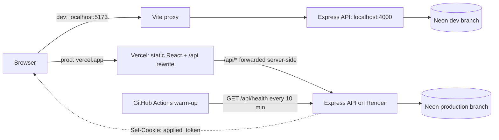
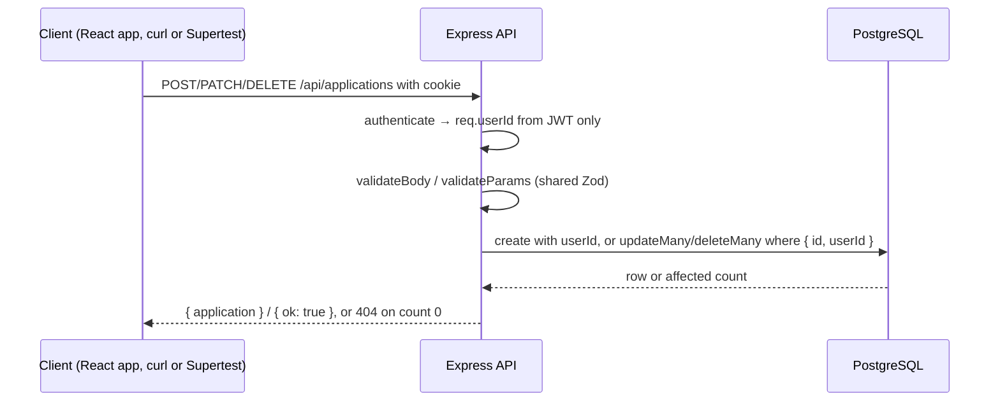
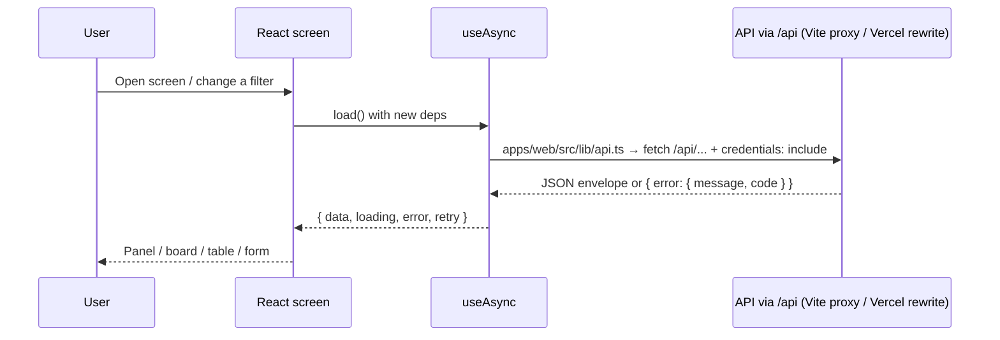

# Architecture

_Last updated: 2026-11-25 — Phase 9 accuracy pass. Auth, CRUD, stats, 19 tests, CI, demo seed and deploy configs are implemented; the live Vercel URL is still pending deploy._

## System overview



In development, Vite forwards `/api` to Express. In production, Vercel is configured to serve the static React build and rewrite `/api/*` to Render; the browser still sees one origin, so the cookie stays `SameSite=Lax` instead of the weaker `SameSite=None`. The scheduled ping is intended to keep Render's free instance awake once its secret is set, and Neon keeps dev and production data in separate branches.

## Folder map

| Path | Responsibility |
|---|---|
| `apps/api/src/app.ts` | Express app: middleware order, routes, error handler. No `listen()` — testable without opening a port. |
| `apps/api/src/server.ts` | Only starts the HTTP server on `PORT`. |
| `apps/api/src/config/env.ts` | Zod-validated env vars. Bad config fails at startup, not mid-request. |
| `apps/api/src/middleware/auth.ts` | Reads the cookie, verifies the JWT, sets `req.userId`. |
| `apps/api/src/middleware/validate.ts` | Parses body, query and `:id` params with shared Zod schemas; returns field issues on failure. |
| `apps/api/src/middleware/rateLimit.ts` | Ten auth attempts per 15 minutes per IP. |
| `apps/api/src/middleware/errorHandler.ts` | Last checkpoint: any thrown error becomes a JSON 500. |
| `apps/api/src/lib/asyncHandler.ts` | Forwards rejected async controller promises to the error handler (Express 4 needs this). |
| `apps/api/src/lib/password.ts` | bcrypt hash/compare helpers, cost 12. |
| `apps/api/src/lib/jwt.ts` | Sign/verify tokens and set/clear the httpOnly cookie. |
| `apps/api/src/routes/auth.routes.ts` | Auth URL → middleware → controller mapping. |
| `apps/api/src/routes/application.routes.ts` | Five application routes behind one `authenticate` checkpoint. |
| `apps/api/src/routes/stats.routes.ts` | `GET /api/stats`, also behind `authenticate`. |
| `apps/api/src/controllers/auth.controller.ts` | Register/login/logout/me logic. |
| `apps/api/src/controllers/application.controller.ts` | CRUD, search/filter/sort and stats. Every query starts with `userId`. |
| `apps/api/tests/` + `vitest.config.ts` | 14 API integration tests against the dev database (applications + auth), with login via Supertest agents. |
| `apps/web/src/**/*.test.tsx` | 5 frontend tests (form validation/transform, route guard) in jsdom via React Testing Library. |
| `.github/workflows/ci.yml` | Push/PR pipeline: install, generate, migrate, typecheck, lint, test, build. |
| `apps/api/prisma/seed.ts` | Idempotent demo account + 10 applications; fixed IDs make `upsert` safe to rerun. |
| `vercel.json` | Vite build/output settings and the `/api/*` rewrite to the Render service. |
| `.github/workflows/warmup.yml` | 10-minute `/api/health` ping for Render's free-instance cold start. |
| `apps/api/prisma/schema.prisma` | Models, enums and indexes — the DB source of truth. |
| `apps/api/prisma.config.ts` | Prisma 7 CLI config: schema path, migration path, `DIRECT_URL`. |
| `apps/api/src/generated/prisma/` | Generated typed client; ignored by git and regenerated by `npm run generate` (also excluded from lint). |
| `apps/api/src/lib/prisma.ts` | One `PrismaClient` with the `pg` adapter, using pooled `DATABASE_URL`. |
| `apps/web/src/lib/api.ts` | Single `fetch` wrapper: `credentials: 'include'`, JSON parsing, error extraction, plus `applicationsApi`/`getStats`. |
| `apps/web/src/hooks/useAsync.ts` | Per-screen data/loading/error/retry and a local row updater. No global store. |
| `apps/web/src/components/ui/States.tsx` | Shared card-shaped loading skeleton, error and empty panels with `role`/`aria-busy`. |
| `apps/web/src/components/ui/ErrorBoundary.tsx` | Class component that catches render errors and offers reload/dashboard recovery. |
| `apps/web/src/components/ui/PageHeader.tsx` | Shared title/description/action row for consistent spacing and type scale. |
| `apps/web/src/pages/NotFoundPage.tsx` | Useful 404 screen (replaced the Phase 5 placeholder). |
| `apps/web/src/components/applications/` | Card, Board, TableView, Toolbar and the shared new/edit form. |
| `apps/web/src/pages/` + `App.tsx` | Dashboard, applications, new/edit, detail screens and their routes. |
| `apps/web/src/context/AuthContext.tsx` | Holds the current user; calls `/api/auth/me` on first load. |
| `apps/web/src/components/auth/` | `ProtectedRoute` and `PublicOnly` route guards. |
| `packages/shared/src/` | Status/type constants, display labels, Zod schemas and inferred types. |
| `docs/` | Living documentation, updated at the end of every phase. |

There is deliberately **no `services/` layer**: the current business logic is a few Prisma calls, and an extra layer would add indirection without hiding complexity.

## Middleware chain

```mermaid
flowchart LR
    R[Request] --> TP[TRUST_PROXY: 1 dev / 2 prod] --> H[helmet security headers] --> J[express.json] --> C[cookieParser] --> RT[route match] --> A[authenticate on protected routes] --> V[validate body/query/params] --> CT[controller] --> P[Prisma] --> RES[JSON response]
    CT -. error .--> EH[errorHandler, last]
```

Order matters: security headers go on every response, parsing happens before validation, auth runs before a protected controller, and the error handler sits last so it can catch everything. `TRUST_PROXY` (default `1`, set to `2` behind the Vercel rewrite) tells Express how many proxy hops to skip so rate limiting sees the visitor's IP rather than Vercel's or Render's.

## Auth flow (implemented)

```mermaid
sequenceDiagram
    participant U as User
    participant W as React app
    participant A as Express API
    participant DB as PostgreSQL

    U->>W: Register (name, email, password)
    W->>W: react-hook-form + shared Zod schema
    W->>A: POST /api/auth/register
    A->>A: rate limit → validate → bcrypt.hash
    A->>DB: create user
    A-->>W: Set-Cookie: applied_token=JWT; HttpOnly; SameSite=Lax; Secure(prod)
    W->>A: GET /api/auth/me (cookie sent automatically)
    A->>A: authenticate → verify JWT signature + expiry
    A->>DB: find user by token subject
    A-->>W: { id, name, email } — never the password hash
    W-->>U: Logged in

    U->>W: Log in later
    W->>A: POST /api/auth/login
    A->>DB: find by email → bcrypt.compare
    A-->>W: New cookie, UI stores returned user

    U->>W: Click Log out
    W->>A: POST /api/auth/logout
    A-->>W: Set-Cookie with empty value → browser deletes it
```

**Why httpOnly:** JavaScript cannot read the cookie, so a script injected into the page cannot steal the token and replay it. The trade-off is that the frontend must ask `/me` who is logged in on page load — `AuthContext` does exactly that, showing a loading state until the answer arrives.

**Why a JWT in a cookie instead of a server session:** no session row to query on every request, and the token carries its own expiry. The trade-off is that revocation is awkward (a stolen token stays valid until it expires), which is why logout clears the cookie and the secret must be strong.

**Why rate limiting:** a public login endpoint is a password-guessing interface; `express-rate-limit` caps attempts per IP so brute force is impractical. `bcrypt` at cost 12 adds a deliberate ~250 ms per guess.

## Request flow for an application write (implemented)



**Ownership scoping:** the ID in the URL is an address, not permission. Every Prisma query — including list, search, filters and stats — starts with `userId` from the verified cookie. Update and delete use `updateMany`/`deleteMany` with `{ id, userId }` rather than `update`/`delete` by ID alone; a body field named `userId` is ignored. When the affected count is zero, the API returns the same `404` for a missing row and another user's row, so the endpoint cannot be used to discover IDs. This is a data-isolation boundary, so it is never optional.

**Sort whitelisting:** Prisma's `orderBy` takes an object key, and a key is not a value you can parameterise. Passing a raw query string into `orderBy` would let a caller choose columns the screen was never designed to expose (including `passwordHash` on a joined user). The shared Zod schema restricts `sort` to `['appliedAt', 'createdAt', 'company']` and `order` to `['asc', 'desc']`; anything else stops at validation with a 400 before Prisma sees it. The whitelist lives in the shared package so the UI's sort options and the API's accepted values cannot drift.

## Frontend data and state (implemented)



**One fetch wrapper:** `apiFetch` prefixes `/api`, sends the httpOnly cookie with `credentials: 'include'`, sets a JSON content type only when there is a body, parses JSON defensively, and turns any non-2xx response into an `ApiError` carrying the server's message and status. Screens never call `fetch` themselves, so cookie handling and error extraction cannot drift. Analogy: one receptionist handles every delivery — the page hands over a request and receives either the answer or a stamped complaint slip.

**State:** the server is the source of truth. Each screen asks `useAsync` for the data it needs (the dashboard fetches stats and recent applications in parallel with `Promise.all`); filters, view choice and form fields stay in local `useState` because nothing else needs them. A status change patches the API and swaps just that row via `setData` instead of refetching the whole list. No Redux or query library was added — one screen's worth of state does not justify a cache.

**Form:** `ApplicationForm` serves new and edit. React Hook Form holds string values (`ApplicationCreateValues = z.input`); `zodResolver(applicationCreateSchema)` validates on blur and produces the transformed output (`z.infer`) sent to the API. `toFormValues` maps ISO dates back to `YYYY-MM-DD` — the only date translation in the app.

**States and responsiveness:** every screen renders loading, error (with retry) or empty panels; the board shows empty columns, and form errors appear inline plus in a focusable summary after a failed submit. At 375px the board is one status-grouped column (no sideways scroll), at `md` two columns, at `lg` five. Tables keep an `overflow-x-auto` wrapper.

**Polish (Phase 6):** the nav becomes two rows on phones with `NavLink` marking the current page, and a skip link leads keyboard users to `<main id="main-content">`. Changing a status remounts the card in another column, so the page restores focus to that card's `<select>` and announces the move in an `aria-live` region. An `ErrorBoundary` around the routes prevents one render error from blanking the app. In dev, Vite binds to all interfaces (`server.host: true`) so IPv4, IPv6, LAN IP and the proxy all resolve — earlier it was IPv6-only, which broke the Firefox mobile viewer.

## Testing

One Vitest config runs both Node/Supertest API tests and jsdom React tests. API tests use the real dev branch locally and an ephemeral Postgres service in CI; each file's `afterAll` deletes only its own users. The frontend tests mock just the auth context — the form test runs the real React Hook Form + Zod resolver, so the blank-to-null transform is verified end to end. Rate-limit tests use distinct `X-Forwarded-For` IPs because the limiter counter is in-memory and per IP.

CI runs on every push and PR: `npm ci` → Prisma generate → `migrate deploy` → typecheck → lint → test → build. The DB password and JWT secret come from repository secrets, so no credential is stored in the repo.

## Deployment

**Render** is configured to run one Node process: `npm run deploy:api` = `prisma migrate deploy && npm run start`. Migrations are applied on boot with `migrate deploy` (never `migrate dev`), so a restart never creates a new migration file. `NODE_ENV=production` makes the JWT cookie `Secure`; `TRUST_PROXY=2` keeps the auth limiter keyed to the visitor through Vercel + Render. `/api/health` is both Render's health check and the warm-up target.

**Vercel** is configured to serve `apps/web/dist` and rewrite `/api/:path*` to the Render URL. Analogy: the browser asks the front desk for everything; the front desk quietly fetches the API from the kitchen. Because there is no cross-origin browser call, there is no CORS middleware to configure — `CORS_ORIGIN` documents the intended browser origin for any future direct client.

**Idempotent seed:** `apps/api/prisma/seed.ts` uses fixed UUIDs and `upsert`, so running `npm run seed` twice leaves 10 demo rows, not 20. The account is deliberately public once deployed; its purpose is to let a visitor explore a populated dashboard without signing up.

**Cold start trade-off:** Render's free tier sleeps when idle, so the first request after a pause waits for boot. A 10-minute GitHub Actions ping is intended to avoid that wait at the cost of Action minutes; a paid Render instance removes the sleep entirely and lets the ping workflow be deleted. Exact dashboard values are in [[HOW_TO]].
