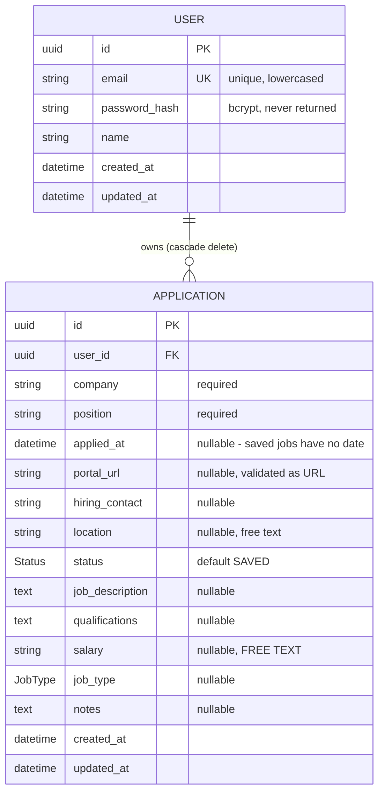
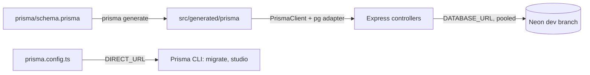

# Database

_Last updated: 2026-11-25 — Phase 9 accuracy pass. The schema, generated client and initial migration are in place; the migration has been applied to the Neon dev branch, and Render applies the same migration with `migrate deploy` on boot._

## Local development: Neon dev branch

Local work uses a dedicated **Neon dev branch**, never the production branch. No Docker and no local Postgres service. `apps/api/.env` (gitignored) must contain two connection strings from that branch:

| Variable | Used by | Purpose |
|---|---|---|
| `DIRECT_URL` | Prisma CLI (`migrate`, `studio`) via `prisma.config.ts` | Direct connection for schema changes |
| `DATABASE_URL` | The running app via `src/lib/prisma.ts` | Pooled connection for queries |

Both are needed because a pooler is great at many short queries but a direct connection is safer for DDL. Prisma 7 removed `directUrl` from the schema, so the CLI's URL is configured in `prisma.config.ts` instead.

## ER diagram

## Tables and fields

**`users`** — one row per account. `email` is unique (the Zod schema lowercases it before it reaches the DB, so `Me@X.com` and `me@x.com` cannot both be created). `password_hash` is a bcrypt digest; the plaintext password is never stored. `created_at` is set once; `updated_at` is maintained by Prisma.

**`applications`** — one row per job. Only `company` and `position` are required; all other fields are nullable so a job can be saved with almost no detail. `salary` is text on purpose: `"$90k–110k"`, `"competitive"` and `"€40/h"` are all valid answers, and a numeric column would reject real input. `appliedAt` stays `NULL` for a `SAVED` job, so the dashboard's "this week" count uses it rather than `createdAt`.

**Relationship:** `users.id → applications.user_id`, one-to-many, `ON DELETE CASCADE`. Deleting an account erases that user's data — the privacy-safe default. Every application query filters on `userId` taken from the JWT, never from the request body (implemented in Phase 4).

## Enums

- `Status`: `SAVED`, `APPLIED`, `INTERVIEW`, `OFFER`, `REJECTED`. Declaration order is kanban column order; `packages/shared/src/constants.ts` mirrors it for the UI.
- `JobType`: `FULL_TIME`, `PART_TIME`, `INTERNSHIP`, `CONTRACT`, `OTHER`.

Storing these as Postgres enums rather than free text means a typo like `"INTERVW"` is impossible and the board always knows its columns. The cost: adding a value needs a migration — that's a deliberate trade for a fixed pipeline.

## Indexes

| Index | Query it serves |
|---|---|
| `(user_id, status)` | Kanban columns and status filter |
| `(user_id, applied_at)` | "Applied this week" and date sorting |
| `(user_id, created_at)` | Default list ordering |

`user_id` leads each index because every screen starts from the signed-in user. Search uses case-insensitive `contains`; at personal-tracker scale that is fine, and a trigram index is the upgrade path if it ever gets slow.

## How Prisma 7 is wired here

- `prisma/schema.prisma` — models, enums and indexes. This is the source of truth.
- `prisma.config.ts` — CLI settings. `import 'dotenv/config'` is required in Prisma 7 because env files are no longer auto-loaded.
- `src/generated/prisma/` — generated TypeScript client, excluded from ESLint and ignored by git; `npm run generate` recreates it after clone and after every schema change.
- `src/lib/prisma.ts` — one shared `PrismaClient` with `@prisma/adapter-pg`. A singleton avoids a new connection pool per request.

**What a migration is:** a versioned SQL change log for the database, like a logbook for a leasehold — each entry records exactly one structural change, in order, so any environment can arrive at the same schema. Prisma writes these files under `prisma/migrations/`, tracks which have been applied in a `_prisma_migrations` table, and refuses to silently rewrite history.

The first migration (`20261125080000_init/migration.sql`) was produced **offline** with `prisma migrate diff --from-empty --to-schema prisma/schema.prisma --script`, because the credentials were not available at the time. It contains the same SQL `migrate dev` would have created; `npm run migrate` later applied it to the dev branch. Deployed environments run `migrate deploy`, which applies this file without creating new ones.

## Deliberately not modelled (scope boundary)

- Remote / hybrid / onsite enum — free-text `location` covers it.
- Pagination — a personal tracker has hundreds of rows, not millions.
- Status history — a post-MVP stretch; it can attach later as `APPLICATION ||--o{ STATUS_EVENT` without changing existing columns.
